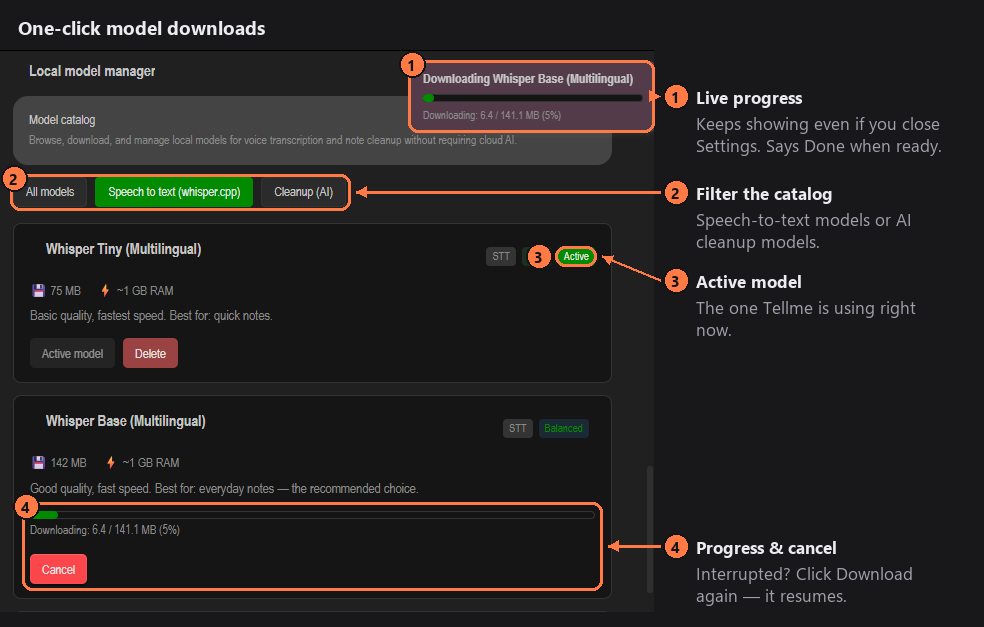
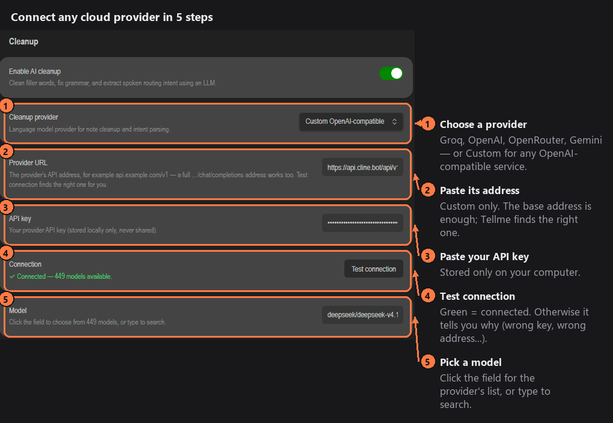
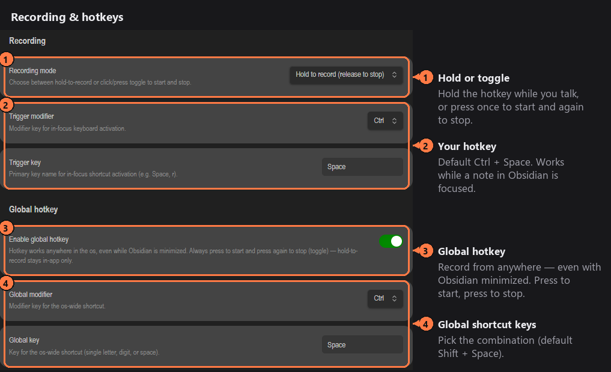

# Tellme

**Speak a note — Tellme transcribes it, cleans it up, and saves it in the right folder of your vault.** Works fully offline, or with your own API key.

Press a hotkey, talk, release. A few seconds later there's a clean Markdown note in your vault: filler words gone, punctuation fixed, reminders turned into tasks, and filed where you said it should go.

### What you say → what you get

> 🎙️ *"um so okay so I was thinking uh that for the project alpha we should like uh move the launch to next friday because you know the design isn't really done yet and um also remind me to call sara about the budget, put this in projects slash alpha"*

Saved in **`projects/alpha/`**:

```markdown
For Project Alpha, we should move the launch to next Friday because the design isn't really done yet.

- [ ] Call Sara about the budget
```

It works the same in other languages — Arabic, for example:

> 🎙️ *"يعني اممم كنت أفكر إنه يعني لازم نشتري خضار بكرة و اممم كمان يعني لازم أتصل بأحمد بخصوص الاجتماع"*
>
> ✍️ كنت أفكر إنه لازم نشتري خضار بكرة، ولازم أتصل بأحمد بخصوص الاجتماع.

*(Real output of the built-in offline model, Gemma 4 E2B, on a laptop.)*

---

## Contents

- [Features](#features)
- [Install](#install)
- [Set up in 2 minutes](#set-up-in-2-minutes) — offline or cloud
- [How to use every feature](#how-to-use-every-feature)
- [Privacy and network use](#privacy-and-network-use)
- [Requirements](#requirements) · [Troubleshooting](#troubleshooting) · [Development](#development)

## Features

- 🎙️ **Hold-to-talk hotkey** in Obsidian, plus an optional **global hotkey** that works while Obsidian is minimized.
- 🗣️ **Speech-to-text offline** with [whisper.cpp](https://github.com/ggml-org/whisper.cpp), or in the cloud with your own key (Groq, OpenAI, OpenRouter, or any OpenAI-compatible service).
- ✨ **AI cleanup** — removes filler words ("um", "like", "يعني"), fixes grammar, keeps your language and every detail, turns action items into `- [ ]` tasks. Offline with a built-in engine ([llama.cpp](https://github.com/ggml-org/llama.cpp)), via Ollama, or via a cloud provider — or switch it off.
- 📂 **Smart filing** — the folder you say, a keyword you mapped, or the best-matching folder in your vault. Anything unclear goes to a `tellme/` folder, so **nothing is ever lost**.
- 📦 **One-click local models** with live progress. Downloads resume after a dropped connection and are verified before use.
- 🔔 Soft start/stop sound and notification, so you always know when it's listening.

## Install

Until Tellme is listed in Obsidian's community plugins, install it manually:

1. Download `main.js`, `manifest.json` and `styles.css` from the [latest release](../../releases/latest).
2. Put them in `<your vault>/.obsidian/plugins/tellme/`.
3. Obsidian → **Settings → Community plugins** → enable **Tellme**.

## Set up in 2 minutes

Tellme needs two things: something that turns **speech into text**, and (optionally) something that **cleans the text up**. Each can run on your computer or in the cloud — mix as you like.

### Option A — fully offline (no account, nothing leaves your computer)

Open **Settings → Tellme → Local model manager**:

1. **Speech:** *Whisper Base* → **Download**. The speech engine is installed with it.
2. **Cleanup:** filter **Cleanup (AI)** → *Gemma 4 (E2B) — recommended* → **Download** (2.6 GB). The cleanup engine is installed with it.

That's it — each download switches itself on when it's done.



> **macOS:** whisper.cpp publishes no ready-made Mac program, so install it once with [Homebrew](https://brew.sh): `brew install whisper-cpp` — Tellme finds it automatically. The cleanup engine downloads normally on Mac.

### Option B — cloud (fast, uses your own API key)

In **Settings → Tellme**, under **Transcription** and/or **Cleanup**:



- **Groq** has a free tier and is very fast — get a key at [console.groq.com](https://console.groq.com).
- Leave **Model** empty to use the provider's default, or pick one from the list.
- **Custom** works with any OpenAI-compatible service: paste its address (for example `api.example.com/v1`) and **Test connection** finds the right endpoint and lists its models.

## How to use every feature

### 1. Record



- **In Obsidian:** click into any note, **hold Ctrl + Space**, talk, release. Prefer tapping? Set **Recording mode** to press-to-start / press-to-stop.
- **From anywhere:** turn on **Global hotkey** (default **Shift + Space**). It works even while Obsidian is minimized: press once to start, again to stop.
- You'll hear a soft chime and see a notification when recording starts and stops (**Recording feedback** — both can be turned off). The status bar shows each step: *recording → transcribing → cleaning up → saving*.
- Prefer the command palette? *Toggle / Start / Stop voice recording* — assign your own hotkeys to them.

### 2. Tell it where to save

Tellme picks the destination in this order:

| Priority | You say… | The note goes to |
| --- | --- | --- |
| 1 | "…**put this in** work **slash** clients" · "…**save to** ideas" | `work/clients/` · `ideas/` |
| 2 | a **keyword** you mapped (see below) | that keyword's folder |
| 3 | nothing, but you mention a folder name that exists in your vault | that folder |
| 4 | nothing recognizable | `tellme/`, marked `routing_status: unresolved` |

The spoken instruction itself is removed from the note. "Slash" becomes `/`.

### 3. Keywords — filing without any AI

**Settings → Highlight keywords → Add keyword**, for example `meeting` → `Work/Meetings`.

- Say **"path meeting"**, **"folder meeting"** or **"highlight meeting"** (Arabic: **مسار** / **مجلد**) and the note goes to `Work/Meetings`.
- Keywords match whole words only — `meeting` never fires inside "fleeting".
- Works even with AI cleanup turned off.

### 4. Choose how notes are written

**Settings → Storage:**

- **Write behavior:** *append* each recording under a timestamped heading in `tellme.md` inside the destination folder, or *create a new file* every time.
- **Default folder:** where unclear notes go (default `tellme`).

Every note carries a timestamp in its frontmatter.

### 5. Speed and hardware

The built-in cleanup engine starts by itself when a note needs cleaning and stops after 5 idle minutes to free memory. The first note after a pause takes a few seconds longer while the model loads.

Measured with Gemma 4 (E2B) on a laptop with a GTX 1070 and an i7-7700HQ:

| | With a graphics card | Processor only |
| --- | --- | --- |
| Typical note | 1–2 seconds | 10–20 seconds |
| Memory | about 2 GB | about 3 GB |

**Use graphics card** (Settings → Cleanup) is on by default; without a usable graphics card the engine simply uses the processor. If cleanup feels slower with it on — possible with weak built-in laptop graphics — switch it off.

### 6. Advanced

- **Your own whisper.cpp build:** Settings → Transcription → *Advanced: use my own whisper.cpp program*.
- **Ollama:** choose *Ollama (local, advanced)* as the cleanup provider if you already run it.
- **Spoken language:** leave on `auto`, or set a language code (e.g. `en`, `ar`) for better accuracy.

## Privacy and network use

Tellme has **no telemetry and needs no account**. Your recordings and notes stay on your computer unless you choose a cloud provider.

It connects to the internet only in these cases:

- **Cloud transcription or cleanup** — only if you select a cloud provider. Your audio (transcription) or transcript text (cleanup) is sent to that provider with your API key. Keys are stored locally in your vault's plugin settings.
- **Model downloads** — only when you click **Download**: model files from [Hugging Face](https://huggingface.co).
- **Engine downloads** — the whisper.cpp and llama.cpp programs, from their official GitHub releases, when you download a model or click the engine's download button. Versions are pinned and every file is checked against a SHA-256 checksum before it is installed.
- **Test connection / model lists** — asks your chosen provider for its list of models.
- **Ollama** — if you choose it, Tellme talks to Ollama on your own computer (`localhost`).

The built-in cleanup engine runs on your computer, listens only on `127.0.0.1`, and requires a random password that changes every time it starts.

### Files outside your vault

- Recordings are written to your system's **temporary folder** while they are transcribed.
- Downloaded engines run as separate programs; they are stored inside your vault's `.obsidian/plugins/tellme/` folder.
- On macOS, Tellme looks for a Homebrew install of whisper.cpp in `/opt/homebrew/bin` and `/usr/local/bin`.

## Requirements

- Obsidian **1.7.0** or newer, **desktop only** (Windows, macOS, Linux).
- Built-in engines have ready-made downloads for Windows (x64/ARM64), Linux (x64/ARM64) and macOS (cleanup engine). Tested on Windows 11.
- About 3 GB of free memory for offline cleanup.

## Troubleshooting

| Problem | Fix |
| --- | --- |
| Hotkey does nothing | Click into a note first. On Windows avoid **Alt + Space** — Windows uses it for the window menu. |
| "AI cleanup warning … Using raw transcript" | The cleanup provider didn't answer in time or returned an error — your note was still saved. With cloud providers, pick the model from the **Model** list instead of typing it. |
| A download stopped | Click **Download** again — it continues where it left off. |
| "No audio captured" | The recording was shorter than about half a second — hold the hotkey a bit longer. |

## Development

```bash
npm install
npm run dev     # rebuild on change
npm run build   # type-check + production build
npm test        # unit tests
npm run lint
```

## Credits

- [whisper.cpp](https://github.com/ggml-org/whisper.cpp) and [llama.cpp](https://github.com/ggml-org/llama.cpp) by ggml-org (MIT).
- [Whisper](https://github.com/openai/whisper) models by OpenAI (MIT).
- [Gemma 4](https://huggingface.co/ggml-org/gemma-4-E2B-it-GGUF) by Google (Apache-2.0).

## License

[MIT](LICENSE) © fateh-beddiaf
